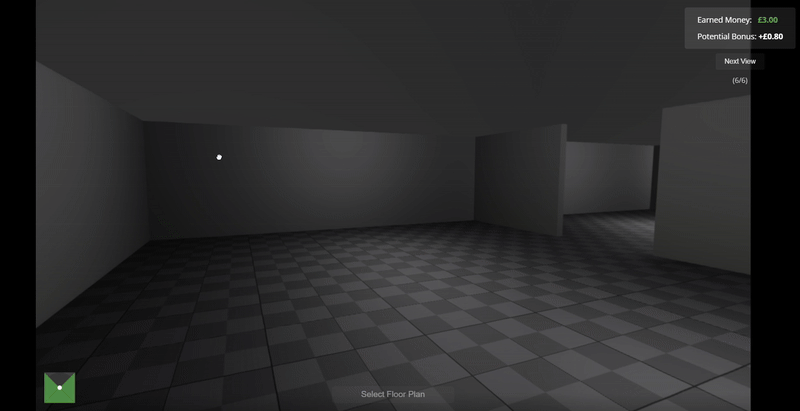

---
# LayoutRecStudy 🖼️🏠  
Web-based 360°-panorama experiment for studying how people reconstruct indoor layouts from a minimal set of views.




---

## Table of Contents  
1. [Project Overview](#project-overview)  
2. [Branches & Versions](#branches--versions)  
3. [Quick Start – run locally in 2 mins](#quick-start--run-locally-in-2-mins)  
4. [Full Setup for Data Collection](#full-setup-for-data-collection)  
   1. [Create a Datapipe project](#step-1)  
   2. [Connect Datapipe ⇄ OSF storage](#step-2)  
   3. [Insert your `experiment_id`](#step-3)  
   4. [Go live](#step-4)  
5. [Built-in participation checks (optional)](#Built-in-participation-checks-(optional))  
6. [Repository Structure](#repository-structure)  
7. [Customising the Stimuli](#customising-the-stimuli)  
8. [Citing or Re-using](#citing-or-re-using) 

---

## Project Overview
* **Goal** – quantify how viewpoint overlap, sequence order, and landmarks affect layout recognition.  
* **Stack** – plain **`jsPsych 8.2.1`** + **`Panolens`**/**`Three.js`**; no server-side code.  
* **Dataflow** – browser → **`jspsych-pipe`** (Datapipe) → **`OSF`** storage (CSV per participant).  
* **Raw-data format & column dictionary** – see the project Wiki @ https://osf.io/8e7pf/ → “Raw_Data README”.

---

## Branches & Versions

| Branch | Experiment version | Main difference |
|--------|--------------------|-----------------|
| `main` | **Experiment 1** | Penalty-based bonus, optional view revisits |
| `exp2` | **Experiment 2** | Final design in thesis (mandatory full-view, flat bonus) |

---

## Quick Start – run locally in 2 mins

```bash
git clone https://github.com/ahmedsaly/LayoutRecStudy.git
cd LayoutRecStudy
git switch exp2          # or: main
python -m http.server 8000
# open  http://localhost:8000/index.html?exp=z8fj&PROLIFIC_PID=TEST
#                                         └───── one of five counter-balanced lists (five: z8fj, r0xl, b2tk, n3qv, w7sd)
```

> `PROLIFIC_PID` can be any placeholder while piloting locally.

---

## Full Setup for Data Collection

1. <a id="step-1"></a>**Create a Datapipe project**  
   * Go to <https://app.datapipe.io> → *New experiment* → choose **jsPsych**.  
   * Copy the generated *Experiment ID* (looks like `fdgEG5ywEnth`).
  
2. <a id="step-2"></a>**Connect Datapipe ⇄ OSF storage**
   Datapipe → Settings › Storage → Connect OSF → authorise & pick the OSF component/folder you want the CSVs to land in.

2. <a id="step-3"></a>**Insert the "experiment_id"**
   Open `index.html` and replace the *Experiment ID* inside the `saveData` helper: 
   ```js
   const saveData = (filename, dataFunction) => ({
     type: jsPsychPipe,
     action: "save",
     experiment_id: "fdgEG5ywEnth",   // <-- replace with your own ID
     …
   });
   ```

4. <a id="step-4"></a>**Go live**  
   * *Push to GitHub → enable GitHub Pages (branch ☑).*
   * **Insert your Prolific study link**
     In `index.html`, search for `prolificURL` (appears twice) and update both  
     ```html
     <!--  index.html  -->
     stimulus: function () {
       /* Replace the placeholder below with the
          *actual* completion code Prolific gives you */
       const prolificURL =
         "https://app.prolific.com/submissions/complete?cc=YOUR_CODE_HERE";
       …
       window.location.href =
         "https://app.prolific.com/submissions/complete?cc=YOUR_CODE_HERE";
     }
     ```  
   * In Prolific (or MTurk), create a study with a URL like:
     ```perl
     https://USER.github.io/LayoutRecStudy/index.html?exp=r0xl&PROLIFIC_PID={}
     ```
---
## Built-in participation checks (optional)
The experiment includes a couple of lightweight, client-side friction checks.
They’re not bullet-proof (determined users can bypass them), but they deter casual repeat attempts and casual inspection.

1. Prevent restarting in the same browser with the same `participant_id`
    ```js
    // Warn on tab close while the study is running
    const beforeUnloadHandler = (e) => {
      e.preventDefault();
      e.returnValue = "Warning message...";
    };
    window.addEventListener('beforeunload', beforeUnloadHandler);
    
    // Block repeat participation via localStorage flag
    const localKey = `layout_exp_started_${subject_id}`;
    if (localStorage.getItem(localKey)) {
      document.body.innerHTML = `
        <div style="text-align:center; padding-top: 20vh;">
          <h2 style="color: red;">You cannot restart this study.</h2>
          <p>Please return to Prolific to complete or contact support if this is an error.</p>
        </div>`;
      throw new Error("Blocked due to localStorage flag.");
    } else {
      localStorage.setItem(localKey, "true");
    }
    ```
    Piloting tips:
    * Use a different `PROLIFIC_PID` in the URL, or
    * Temporarily comment out the block above while testing.

2. Make casual DevTools access a hassle
   ```html
    <script>
    // Block right-click menu
    document.addEventListener("contextmenu", (e) => e.preventDefault());
    
    // Block common DevTools shortcuts (F12, Ctrl/Cmd+Shift+I/J/C)
    document.addEventListener("keydown", (e) => {
      if (
        e.key === "F12" ||
        (e.ctrlKey && e.shiftKey && (e.key === "I" || e.key === "J" || e.key === "C")) ||
        (e.metaKey && e.altKey && e.key === "C") // Mac: Cmd+Option+C
      ) {
        e.preventDefault();
        alert("Not Allowed!!");
      }
    });
    </script>
   ```
   Again, this is not security—just friction. For clean piloting, comment this block out.

   
---

## Repository Structure

```
LayoutRecStudy/
│
├─ panorama/          # JPEG/PNG panoramas & four-option floor-plan images
├─ Tutorial_data/     # assets used in the practice trial
├─ scripts/           # optional Python helpers (layout cleaning, AGP, etc.)
├─ index.html         # main experiment (branch-specific)
└─ README.md
```
## Customising the Stimuli
1. Drop new panoramas inside panorama/<Building_ID>/… (follow the existing naming style).

2. Edit layoutConfigs (≈ line 400 in index.html) to point at your images & correct answer.

3. If you change the number of layouts or views, update conditionPermutations accordingly.

---

## Citing or Re-using

If you use this code or stimuli, please cite:

> Aly, A. S. (2025). *Building Layout Recognition from Minimal 360° Views:  
> A Monetary‑Incentivized Framework on the Effects of Viewpoint Overlap, Sequencing, and Landmarks.* MSc thesis, University of Münster.

---

